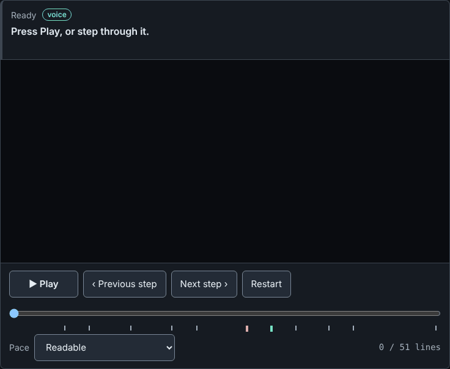

# Innkeeper

> Crash-safe, cost-capped, gated execution for coding agents, in plain files.

Innkeeper seats several Claude Code agents around one job board made of ordinary files. A worker
claims a job under a lease, does the work, and a **separate gate reviews it — and the gate can
refuse.** The worker reads the refusal, fixes the work, and the result merges exactly once.
Everything is a file on disk, so you can `ls` the run while it happens, and a worker that dies
mid-job loses nothing: the next one picks the job up from the file. Spend is capped before a call
starts, not after.

## First ten minutes

On Linux or macOS, with `bash`, `git` and `python3` installed (details under
[Requirements](#requirements)). The suite is verified in CI on every pull request on Ubuntu, as
root in an `ubuntu:24.04` container, and on macOS under the stock `/bin/bash` 3.2 with the
system (BSD) tools on `PATH` and nothing else but `python3` and `gitleaks`
(`.github/workflows/ci.yml`). Nothing here calls a model, uses the network or spends money.

| Run this | Takes | The last lines you should see |
|---|---|---|
| `git clone https://github.com/dillondevoe/innkeeper && cd innkeeper` | seconds | git's own clone output |
| `bin/hello-party.sh` | ~1 s | `Nothing else on your machine was touched.` then `(sandbox removed; --keep to inspect it)` |
| `bin/smoke.sh` | ~1 s | `smoke complete.` then `(sandbox removed; --keep to inspect it)` |
| `bin/murder-quest.sh` | ~7 s | `murder-quest complete.`, two lines about the two kills, then `(sandbox removed; ...)` |
| `bash tests/run-all.sh` | ~2 min | `suite: 21/21 batteries green (expected 21), red=0 cannot-run=0`, exit 0 |

Without `gitleaks` installed, the last line is instead
`suite: 20/21 batteries green (expected 21), red=0 cannot-run=1` and the exit code is 1; that is
expected, and the line above it names the missing scanner (see "Run them all" below). Each demo
exits 0 on success and non-zero otherwise, takes `--keep` (keep the sandbox) or `--help`, and
refuses any other argument with a usage line. A failure says what went wrong and what to do next.

## You can watch one finish without installing anything

No clone, no terminal, no login:



That GIF, and the `replay/index.html` page it's a recording of, are both built from
`fixtures/recorded-quest.json` — a literal capture of one real `bin/hello-party.sh` run, not a
mockup. `bin/record-quest.sh` makes the fixture, `bin/render-replay.sh` makes the page;
`tests/bin-record-quest-selftest.sh` fails the suite if either one drifts from a fresh run. The
page is one self-contained file (no network requests) with play/pause, step, scrub and a legend
of the four roles; the GIF is a screen capture of that page, taken by hand and not checked by
the suite.

**Status: alpha. Working prototype, not a product.** Innkeeper is an independent project, not
affiliated with or endorsed by Anthropic. "Claude" and "Claude Code" are trademarks of Anthropic;
they are used here only to describe what the tool runs.

Automating this against a personal Claude subscription may breach Anthropic's terms — read
"Before you run anything live" below before any live run.

## Why not just use built-in agent teams?

Use them if they fit. Innkeeper is for the cases where you want the run to outlive any one
process and want every step on disk where you can read it:

- **The state is plain files, not a session.** Quests, leases, gate verdicts and the merge
  record are files on a bus directory. Kill a worker, close the laptop or reboot, and the next
  worker picks the quest up from the file. `bin/murder-quest.sh` does this with real `kill -9`s.
- **The gate is a separate party member that can say no.** The worker does not mark its own
  work done. The gate refuses with a written reason, the worker reads it and tries again.
- **The merge happens exactly once.** The commit point is one `ln`, so two workers racing, or a
  worker killed mid-merge, cannot land the same change twice ([LIMITS.md](LIMITS.md)).
- **The spend is capped before a call starts, not after.** See below.
- **Nothing is hidden in a context window.** You can `ls` the bus mid-run and see who holds
  what.

The cost of that: more moving parts than one session, and file-level coordination instead of
in-memory messages. For a quick task in one sitting, one session is simpler.

## What it costs

- **The demos and the test suite cost nothing.** `bin/hello-party.sh`, `bin/murder-quest.sh`
  and `tests/run-all.sh` never call a model or the network.
- **A live run is refused unless you opt in** (`INNKEEPER_LIVE=1`; `bin/live-party.sh` keeps
  its own spend ledger in its sandbox, and no model call is made without one), and it
  stops starting new model calls at a ceiling: `INNKEEPER_LIVE_MAX_USD`, default `$3.00`.
- **The one recorded live run cost $0.9569 over 2 model calls.** One run is a sample, not a
  price list; your quest, model and turn limit change it.
- The ceiling is checked between calls, so the last call can go past it. Leave headroom.
  The exact guarantees and their conditions are in [LIMITS.md](LIMITS.md).
- Billing follows your own `claude` login. Read the API-key note below before automating.

## What works, what is a toy

Works, and is checked by the test suite:

- `bin/hello-party.sh`: an end-to-end scripted run that finishes in about a second with no model,
  no network, and nothing written outside a temporary sandbox. Verified by running it: exit 0.
- `bin/murder-quest.sh`: two workers are really `kill -9`'d mid-quest and each quest still merges
  exactly once. Self-asserting; exits non-zero if the world does not match. Verified: exit 0.
- A file-based bus, quests as YAML ([SCHEMA.md](SCHEMA.md)), a lease, a deterministic script gate,
  an exactly-once merge, and a refuse-by-default spend gate for live runs
  (`bin/live-preflight.sh` exits 1 unless `INNKEEPER_LIVE` is exactly `1` and the other
  conditions are met; it spends nothing).
- 21 test batteries behind one verdict: `bash tests/run-all.sh`.

A toy or unfinished:

- There is exactly one quest: add `--version` to a small toy tool. The scripted run uses scripts
  in place of models, so it proves the plumbing, not model quality. Only a single live run is
  recorded.
- The roster in `party.yaml` is flat; the "class" names (cleric, squire...) and per-seat model
  names are labels that nothing consumes. Only the `claude` CLI is wired as a backend.
- No installer yet; the current release tag is `v0.1.0-alpha`.
- The test batteries share repo-level `state/`, so they cannot run in parallel (see below).
- Not built: the tavern view (watching a quest live, not just a recording), the lease's second half.
- The live worker is granted `--permission-mode acceptEdits` with tools `Read,Edit,Write,Glob,Grep`
  (no Bash). A hostile prompt could still modify files in the working directory it is given. Do
  not widen this to skip permissions.

## Watch a quest finish

```sh
git clone https://github.com/dillondevoe/innkeeper && cd innkeeper
bin/hello-party.sh
```

A party of four takes one job and finishes it, in a sandbox, in about a second: a quest is
posted; a worker claims it under a lease (a second instance of that worker stands down); a
researcher reads the tool and briefs the worker; the worker adds a `--version` flag to a
real tool in a real git repo; **the gate refuses it** — the flag exits 0 and prints nothing
— the worker reads the refusal and fixes it; the gate passes; the result merges exactly
once, and a second merge is refused; the voice tells you what happened.

No model is called, nothing leaves the machine, nothing outside the sandbox is written, and
the sandbox is removed on exit (`--keep` to inspect it). The refusal is not decoration: with
the worker's first attempt made correct, the run FAILS rather than passing quietly, and
`tests/bin-hello-party-selftest.sh` asserts exactly that.

```sh
bin/smoke.sh
```

is the older, smaller thing: four brains boot, each writes one line to the bus, and the
herald prints them in roster order. Nothing is worked on, refused or merged — it is the
WIRING proof, and it stays because every hop in it is the real script (the roster from
`bus/actor.sh`, the quest record from `bus/quest.sh`, dispatch from `bus/enqueue.sh`,
delivery from `staff/inbound.sh`), so when it breaks, something real broke.

Record shapes are in [SCHEMA.md](SCHEMA.md). Every script here is paired with a battery
under `tests/`. Run them all, and get one verdict with an exit code (about two minutes):

    bash tests/run-all.sh

The last line is the verdict; on a machine with every requirement installed it reads
`suite: 21/21 batteries green (expected 21), red=0 cannot-run=0`.

It prints GREEN / RED / CANNOT-RUN per battery, shows the failing arms inline, and fails if
the number of batteries is not the number it expects — a suite that finds its own members by
glob is all green the moment a file goes missing. (The runner's own battery matches that glob
and would recurse, so run it directly: `bash tests/run-all-selftest.sh`.)

The port gate's battery needs [gitleaks](https://github.com/gitleaks/gitleaks) on `PATH`, or
`INNKEEPER_GITLEAKS` pointing at it. Without it that battery reports CANNOT-RUN with the reason
rather than a verdict, because every one of its arms asserts a real scan result. **A CANNOT-RUN
fails the suite** (`run-all.sh` exits non-zero), the same as a RED: a battery that could not run
is not a battery that passed, and the fresh-clone default on a machine without gitleaks is
therefore rc=1 until you install it.

**Run the suite once at a time.** Two concurrent `run-all.sh` runs produce reds that neither
run produces alone: measured on one host, `bin-murder-quest`, `bus-merge` and
`bin-hello-party` each went red in 3 of 6 paired runs, while `bin-murder-quest` alone was
20/20 green and 12/12 green against a second copy of itself. The batteries share
repo-level state (`state/`), so a second suite is not another observer — it is another
writer. Isolating them is open work; until then a red from a machine running two suites at
once is a fact about the machine.

One battery is not a battery at all: `tests/portability-selftest.sh` greps the shell sources
for GNU-only constructs (`tac`, `sed -i`, `$BASHPID`, BRE `\|`, `grep -P`, `readlink -f`,
`date -d`). It exists because this repo was 15/15 green on Linux and 9/15 with a visibly
broken demo on macOS on the same commit — the batteries catch these faithfully, but only on
a machine that has the BSD tools, which the author's machine is not. The macOS CI job is that
machine: it runs the whole suite under `/bin/bash` 3.2 with GNU tools kept off `PATH`, so this
grep is the early warning, and the macOS job is the measurement.

## Then kill a worker

```sh
bin/murder-quest.sh
```

It takes about seven seconds: most of that is two deliberate three-second waits for a dead
worker's lease to go stale. Two workers are really `kill -9`'d mid-quest — one before it commits its work, one *after*
committing but before it could tell anyone. Both quests land exactly once: the first is redone
by whoever takes over, and the second is not redone at all, because the finished result is
already there and the takeover is told so. The script asserts all of that and exits non-zero if
the world does not match, so it cannot pass by printing.

Still under construction: the tavern view (watching a quest live — the replay half, the
recording at the top of this page, is built), and the lease's second half.

## Before you run anything live

**Default to an Anthropic API key (Claude Console billing) for automation.** The live run
(`bin/live-party.sh`) shells out to the `claude` CLI in headless mode, and a party runs several
sessions. Anthropic's Consumer Terms (https://www.anthropic.com/legal/consumer-terms, section 3,
effective October 8, 2025) prohibit accessing the Services "through automated or non-human means,
whether through a bot, script, or otherwise" except "when you are accessing our Services via an
Anthropic API Key or where we otherwise explicitly permit it". Anthropic's Claude Code legal page
(https://code.claude.com/docs/en/legal-and-compliance) says "Advertised usage limits for Pro and
Max plans assume ordinary, individual usage of Claude Code and the Agent SDK", and that developers
building products "should use API key authentication". Running several concurrent sessions on a
personal subscription may exceed "ordinary, individual usage"; this README does not decide that
for you. Quotes are as fetched on 2026-10-04 and the terms change, so read the current pages
(https://www.anthropic.com/legal) yourself. This is not legal advice.

Innkeeper never reads, stores or forwards credentials; it runs the unmodified `claude` binary
with whatever login or environment you already have.

## Requirements

- **The demos** (`bin/hello-party.sh`, `bin/smoke.sh`, `bin/murder-quest.sh`): `bash` (3.2 or
  later; macOS's stock bash is what the macOS CI job runs), `git`, and the standard POSIX tools (`awk`, `sed`,
  `mktemp`, ...). They also run without `python3`.
- **The test suite** (`tests/run-all.sh`): the above plus `python3` and
  [gitleaks](https://github.com/gitleaks/gitleaks) (the port-gate battery reports CANNOT-RUN
  without it, and a CANNOT-RUN fails the suite). `tmux` is not needed: the tests stub it.
- **Live runs** (`bin/live-party.sh`): the above plus the `claude` CLI and `python3`
  (`bin/live-cost.sh` totals the ledger with it); `jq` is optional and is used to read each
  call's cost when present. Install `claude` yourself; do not vendor or redistribute it.
- `tmux` only for real runs of `lifecycle/recycle.sh`.

MIT. See [LICENSE](LICENSE).
